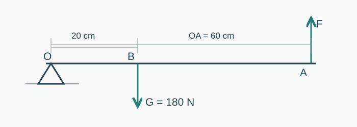
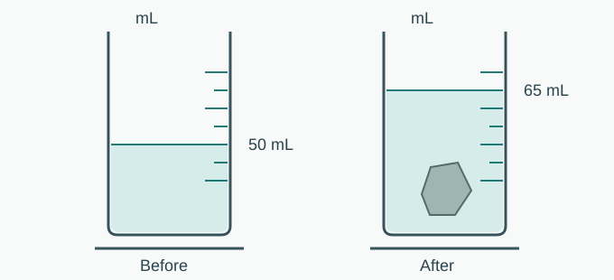

# 北京中考风格 · 原创模拟卷（一）

知序原创 · 参考北京中考公开卷面结构与命题风格；非官方真题，非官方预测卷

26题，70分，建议70分钟。

## 1. 物理量与单位（单选题，2分）

### 一、单项选择题（12题，每题2分，共24分）
本卷为原创模拟卷，非官方真题。建议70分钟完成，全卷70分。取 $g=10\,\mathrm{N/kg}$，水的密度为 $1.0\times10^3\,\mathrm{kg/m^3}$。

下列单位中，属于能量单位的是（　）。

A. 瓦特（W）

B. 焦耳（J）

C. 牛顿（N）

D. 帕斯卡（Pa）

## 2. 湖面倒影（单选题，2分）

游览公园时，小林看到树木在平静湖面中的倒影。形成倒影的主要原因是（　）。

A. 光的反射

B. 光的折射

C. 光沿直线传播

D. 光的色散

## 3. 运动后的降温（单选题，2分）

运动后皮肤表面的汗液逐渐变干，人感觉凉爽。有关说法正确的是（　）。

A. 汗液凝固时吸热

B. 汗液液化时吸热

C. 汗液蒸发时吸热

D. 汗液升华时放热

## 4. 家庭安全用电（单选题，2分）

有关家庭用电，下列做法符合安全要求的是（　）。

A. 用湿布擦拭正在工作的插座

B. 将用电器金属外壳接在零线上代替接地

C. 把控制电灯的开关接在火线上

D. 发现有人触电时直接用手拉开

## 5. 敲钟的声音（单选题，2分）

同一口钟，用较大的力敲击，通常听到的声音更响，主要是因为钟的（　）。

A. 振动频率更高

B. 振动幅度更大

C. 音色一定改变

D. 声音在空气中传播更快

## 6. 公交车制动（单选题，2分）

行驶的公交车突然制动时，站立乘客的上身容易向前倾。正确解释是（　）。

A. 乘客受到向前的惯性力

B. 制动使乘客的惯性增大

C. 乘客的上身由于惯性仍要保持原来的运动状态

D. 乘客只有在制动时才有惯性

## 7. 减小地面压强（单选题，2分）

下列设计主要用于在压力一定时减小压强的是（　）。

A. 滑雪板做得较宽

B. 图钉尖做得很细

C. 菜刀刀刃磨得锋利

D. 注射针针头做得很尖

## 8. 摆球的机械能（单选题，2分）

忽略空气阻力和轴处摩擦，摆球从一侧最高点向最低点运动时（　）。

A. 动能减小，重力势能增大

B. 动能增大，重力势能减小

C. 动能和重力势能都增大

D. 机械能不断减小

## 9. 欧姆定律应用（单选题，2分）

一个阻值为20 Ω的定值电阻，两端电压为6 V，流过它的电流为（　）。

A. 120 A

B. 3.3 A

C. 1.2 A

D. 0.30 A

## 10. 发电机的原理（单选题，2分）

手摇发电机转动时能使小灯泡发光。其发电部分主要利用的原理是（　）。

A. 电流的热效应

B. 通电导体周围存在磁场

C. 电磁感应

D. 磁极间的相互作用

## 11. 滑轮组效率（单选题，2分）

用滑轮组匀速提升重400 N的物体，动滑轮总重100 N。承重绳段为2段，不计绳重和摩擦。物体在10 s内升高2 m。下列说法正确的是（　）。

A. 绳自由端拉力为250 N

B. 绳自由端移动距离为2 m

C. 机械效率为100%

D. 拉力的功率为200 W

## 12. 杠杆模型（单选题，2分）

如图，轻质杠杆水平平衡，O为支点，OA=60 cm，OB=20 cm。在B点悬挂重180 N的物体，在A点施加竖直向上的力F。不计杠杆自重，F的大小为（　）。

图1 杠杆模型（示意图不按比例）

A. 540 N

B. 60 N

C. 180 N

D. 360 N

## 13. 内能与热量（多选题，2分）

### 二、多项选择题（3题，每题2分，共6分）
每题正确选项多于一个；全对2分，选对但不全1分，有错选或未选0分。

关于内能和热量，下列说法正确的有（　）。

A. 用热水袋取暖，是通过热传递改变手的内能

B. 相同质量的不同物质吸收相同热量，比热容较大的物质温升较小（均不发生物态变化）

C. 温度高的物体，其内能一定比温度低的物体大

D. 燃料的热值随所取燃料的质量增大而增大

## 14. 称重法与浮力（多选题，2分）

一个不吸水的实心物体在空气中静止时，弹簧测力计示数为5.0 N；完全浸没在水中且不接触容器时，示数为3.0 N；完全浸没在另一种液体中时，示数为3.4 N。忽略空气浮力。下列说法正确的有（　）。

A. 物体在水中受到的浮力为2.0 N

B. 物体的密度为 $1.0\times10^3\,\mathrm{kg/m^3}$

C. 物体的体积为200 cm³

D. 另一种液体的密度为 $0.8\times10^3\,\mathrm{kg/m^3}$

## 15. 光敏传感电路（多选题，2分）

某模型电路由恒压6 V电源、20 Ω定值电阻和光敏电阻串联组成。光敏电阻随光照变化的数据见表。电表理想，电阻均在安全范围内。当光照由100 lx增强到400 lx时，下列说法正确的有（　）。

| 光照强度/lx | 光敏电阻/Ω |
| --- | --- |
| 100 | 40 |
| 200 | 20 |
| 400 | 10 |

A. 电路总电阻增大

B. 电路电流由0.10 A增大到0.20 A

C. 光敏电阻两端电压增大

D. 定值电阻消耗的电功率增大

## 16. 磁体与电动机（实验题，4分）

### 三、实验探究题（8题，共28分）

实验现象与原理：

**（1）磁极相互作用（2分）**

把一根可自由转动的条形磁体悬挂起来，用另一磁体的N极接近它的N极，观察到两个N极互相________。

**（2）简易电动机（2分）**

线圈通电后在磁场中转动，说明通电导体在磁场中受到________。

## 17. 物态变化与分子运动（实验题，4分）

**（1）物态变化（1分）**

冬季窗玻璃内侧出现小水珠，这是室内水蒸气遇冷发生________形成的。

**（2）比较扩散快慢（3分）**

小林在两个相同烧杯中装入等量的冷水和热水，同时各滴入一滴相同的墨水，静置观察。发现墨水在热水中散开更快。请写出实验结论，并说明为什么要使用等量的水和相同的墨水。

## 18. 光的反射与凸透镜（实验题，4分）

某小组记录光反射实验数据，并开展凸透镜成像实验。

| 入射角/° | 反射角/° |
| --- | --- |
| 20 | 20 |
| 35 | 35 |
| 50 | 50 |

**（1）反射规律（1分）**

根据表格，反射角________入射角。

**（2）像的性质（1分）**

焦距为10 cm的凸透镜位于光具座50 cm处，蜡烛在20 cm处，移动光屏获得清晰的像。此像是倒立、________的实像。

**（3）实验设计（2分）**

若要探究“同一凸透镜所成实像的大小与物距是否有关”，请写出接下来应怎样改变实验条件、调整器材并比较结果。

## 19. 伏安法测电阻与电路作图（实验题，3分）

器材有电源、开关、电流表、电压表、滑动变阻器、待测定值电阻和导线。用伏安法测量待测电阻，电表及滑动变阻器量程均合适。

**（1）实验原理（1分）**

请写出用电压U、电流I表示电阻R的公式：R=________。

**（2）画实验电路图（2分）**

画出可完成测量且可调节电流的电路图，标注电流表、电压表、待测电阻和滑动变阻器。请选择“手写作答”绘制，或上传纸面作图照片；也可用文字完整描述各元件连接关系供人工评阅。

## 20. 液体压强的探究与纠错（实验题，4分）

小组使用同一个压强计研究液体压强，U形管内液体相同。记录如下（各次实验前均检查装置正常）：

| 实验 | 液体 | 探头深度/cm | U形管液面高度差/cm |
| --- | --- | --- | --- |
| 甲 | 水 | 5 | 4 |
| 乙 | 水 | 10 | 8 |
| 丙 | 酒精 | 8 | 5 |

**（1）方法与变量（2分）**

液体压强大小通过U形管液面的________反映。比较甲、乙可研究压强与________的关系。

**（2）评价与改进（2分）**

同学直接比较乙和丙，认为“液体压强与密度有关”。指出这一比较的不合理之处，并写出具体改进办法。

## 21. 串联电路电压与实验数据（实验题，4分）

小组将两个不同规格小灯泡串联，通过调整电路取得多组数据。U₁、U₂分别为两灯电压，U为两灯总电压。

| 次数 | U₁/V | U₂/V | U/V |
| --- | --- | --- | --- |
| 1 | 0.8 | 0.4 | 1.2 |
| 2 | 1.2 | 0.6 | 1.8 |
| 3 | 1.6 | 0.8 | ________ |

**（1）数据与关系（1分）**

表格中第3次U的空格填数值（1分，见表中输入框）。根据数据，U与U₁、U₂的关系可写成U=________。

**（2）证据的充分性（2分）**

小明认为只做一次实验就可以证明上述关系适用于一般串联电路。你是否赞同？请从器材或测量次数的角度给出改进建议及理由。

## 22. 用量筒和天平测密度（实验题，2分）

测量一个不吸水小石块的密度，天平测得质量36.0 g。量筒中水体积及石块完全浸没后总体积如图；石块不接触容器壁，忽略悬线体积。

图2 排水法测体积（示意图）

石块体积为________ cm³，密度为________ g/cm³。

## 23. 比较液体吸热性能（实验题，3分）

两个相同容器分别盛质量均为200 g的液体A、B，用两个完全相同且功率保持不变的电加热器同时加热。加热时间相同，均未沸腾，忽略热量损失，实验数据见表。

| 液体 | 初温/℃ | 末温/℃ |
| --- | --- | --- |
| A | 20 | 40 |
| B | 20 | 30 |

**分析与论证（3分）**

哪种液体的吸热性能更强？请结合吸收的热量、质量、温度变化以及比热容的含义说明理由。

## 24. 校园温室的自动通风（科普阅读题，4分）

### 四、科普阅读题（1题，共4分）
#### 校园温室的自动通风

校园科技小组设计了一台教学模型：太阳能电池板为风扇和控制电路供电，将太阳能转化为电能。温度传感器把温度变化转化为电信号，控制器据此开启或关闭风扇。该模型电源电压稳定时，传感电路由定值电阻R₀和热敏电阻R串联组成，R的阻值在20～40℃范围内随温度升高而减小。控制器检测R₀两端电压；温度达到30℃时开启风扇，温度降至26℃时关闭风扇，26～30℃之间保持原来状态，以避免频繁开关。本文参数为教学模型设定。

**（1）提取信息（1分）**

太阳能电池板把太阳能转化为________。

**（2）电路迁移（1分）**

温度由20℃升至30℃时，电源电压保持不变，R₀两端电压如何变化？

A. 增大

B. 减小

C. 不变

D. 先减小后增大

**（3）分析控制策略（2分）**

某时刻温室温度为28℃。只知道这一温度，能否确定风扇一定正在转动？结合材料说明理由。

## 25. 电热饮水机的功率与电阻（计算题，4分）

### 五、计算题（2题，每题4分，共8分）
请写出必要公式、代入过程和结果。

某饮水机正常加热时电压为220 V、加热功率为880 W，可把加热部分视为阻值不变的电阻。此次饮水机在220 V电压下正常加热，水吸收的热量为 $1.32\times10^5\,\mathrm J$，加热效率为75%。忽略其他耗电。

（1）求正常加热时的电流和加热电阻的阻值。（2分）

（2）求此次加热所需时间。（2分）

## 26. 电动运输车的做功与节能（计算题，4分）

一辆电动运输车在水平道路上以10 m/s做匀速直线运动，此时总阻力为600 N。电动机把电能转化为牵引力所做机械功的效率为80%，忽略车上其他设备耗电。改进轮胎后，在相同速度下总阻力减小10%，电动机效率保持不变。

（1）求改进前牵引力的大小和牵引力的功率。（2分）

（2）以相同速度各行驶100 s，改进后比改进前节省多少电能？（2分）

---

# 参考答案与评分要点

## 1. 物理量与单位

正确选项：B。

焦耳是功、能量和热量的单位；瓦特是功率单位，牛顿是力的单位，帕斯卡是压强单位。

## 2. 湖面倒影

正确选项：A。

平静湖面近似平面镜，树木反射的光经水面反射进入人眼，形成虚像。

## 3. 运动后的降温

正确选项：C。

液态汗液变为水蒸气是汽化中的蒸发，需要吸收热量，从皮肤吸热使人感到凉爽。

## 4. 家庭安全用电

正确选项：C。

开关接火线可在断开后切断灯与火线的连接；湿物导电风险较大；金属外壳应按规范保护接地；救援应先切断电源。

## 5. 敲钟的声音

正确选项：B。

响度与振幅有关，用力较大通常使振幅增大；音调主要与频率有关，声速主要由介质及其温度决定。

## 6. 公交车制动

正确选项：C。

惯性是物体保持原运动状态的性质，不是一种力，且始终存在。脚随车减速，上身仍趋于保持原速度而前倾。

## 7. 减小地面压强

正确选项：A。

由 $p=F/S$，压力相同时增大受力面积可减小压强。其余三项都通过减小面积来增大压强。

## 8. 摆球的机械能

正确选项：B。

摆球下降时重力势能转化为动能；忽略阻力和摩擦时机械能守恒。

## 9. 欧姆定律应用

正确选项：D。

由 $I=U/R=6/20=0.30\,\mathrm A$。注意单位和除法关系。

## 10. 发电机的原理

正确选项：C。

闭合电路的一部分导体在磁场中做切割磁感线运动时产生感应电流，这是发电机的基本原理；电动机利用通电导体在磁场中受力。

## 11. 滑轮组效率

正确选项：A。

$F=(G+G_{动})/2=250\,\mathrm N$；自由端移动4 m；有用功800 J，总功1000 J，效率80%；拉力功率100 W。

## 12. 杠杆模型

正确选项：B。

由 $F\cdot OA=G\cdot OB$，$F=180\times20/60=60\,\mathrm N$。动力臂为阻力臂的3倍，是省力杠杆。

## 13. 内能与热量

正确选项：A、B。

A正确；由 $Q=cm\Delta t$ 可知B正确。内能还与质量、物态等有关，不能只比较温度；热值是燃料的特性，不由所取质量决定。

## 14. 称重法与浮力

正确选项：A、C、D。

水中浮力5−3=2 N，体积 $V=F浮/(ρ水g)=2\times10^{-4}\,\mathrm{m^3}=200\,\mathrm{cm^3}$；质量0.5 kg，物体密度2500 kg/m³；另一液体浮力1.6 N，密度800 kg/m³。

## 15. 光敏传感电路

正确选项：B、D。

总电阻由60 Ω降为30 Ω，电流由0.10 A升至0.20 A。定值电阻电压由2 V升至4 V，光敏电阻电压由4 V降至2 V；定值电阻功率由0.2 W升至0.8 W。

## 16. 磁体与电动机

（1）同名磁极相互排斥。（2）通电导体在磁场中受力，线圈两侧受力可使其转动；电动机将电能转化为机械能。

## 17. 物态变化与分子运动

（1）液化，1分。（2）温度越高，分子热运动越剧烈，扩散越快，1分；控制水量等条件相同，1分；墨水种类和滴入量相同，使温度成为主要变量、便于比较，1分。水应保持静置、避免搅拌等宏观运动干扰。合理等价表述可给分。

## 18. 光的反射与凸透镜

（1）等于，1分。（2）物距30 cm大于2f，成倒立缩小实像，1分。（3）保持同一透镜，改变蜡烛到透镜的距离且物距大于焦距，1分；每次移动光屏至像清晰，比较并记录像的大小，1分。不能把模糊程度当作像的大小。

## 19. 伏安法测电阻与电路作图

（1）R=U/I，1分。（2）电源、开关、电流表、滑动变阻器与待测电阻串联，1分；电压表并联在待测电阻两端，电表正负连接合理，1分。滑动变阻器有效接入须选一个上接线柱和一个下接线柱，闭合前调至最大阻值。图或完整等价描述由人工评阅。

## 20. 液体压强的探究与纠错

（1）高度差、深度，各1分。（2）乙、丙液体种类和探头深度同时改变，没有控制深度相同，1分；将水与酒精中探头放在相同深度，其他条件相同，再比较高度差，1分。酒精密度小于水时，在相同深度压强较小。

## 21. 串联电路电压与实验数据

表格U=2.4 V，1分；U=U₁+U₂，1分。开放题：不赞同，仅一次存在偶然性且不能充分支持一般结论，1分；更换不同规格灯泡/改变适当条件，多次测量比较，以增强结论普遍性，1分。

## 22. 用量筒和天平测密度

石块体积V=65−50=15 cm³，1分；ρ=m/V=36.0/15=2.4 g/cm³，1分。输入框后已显示单位，填写数值即可。

## 23. 比较液体吸热性能

B液体吸热性能更强。相同功率的加热器工作相同时间，由Q=Pt知两液体吸收热量相同，1分；两液体质量相等，A升温20℃、B升温10℃，1分；由c=Q/(mΔt)，B比热容更大（为A的2倍），相同质量升高相同温度时B吸热更多，1分。不能只说“B温度低所以强”。

## 24. 校园温室的自动通风

（1）电能，1分。（2）A，1分。温度升高时R减小，串联总电阻减小，电流增大，U₀=IR₀增大。（3）不能确定，1分；28℃处于26～30℃保持原状态区间，若此前升至30℃开机后回落到28℃则仍转动，若此前在26℃关机后升至28℃则不转动，说明取决于此前状态，1分。

## 25. 电热饮水机的功率与电阻

（1）I=P/U=880/220=4 A，1分；R=U²/P=220²/880=55 Ω，1分。（2）电能W=Q/η=1.32×10⁵/0.75=1.76×10⁵ J，1分；t=W/P=1.76×10⁵/880=200 s，1分。列式和单位合理，等价方法可给分。

## 26. 电动运输车的做功与节能

（1）匀速直线运动时受力平衡，F=f=600 N，1分；P=Fv=600×10=6000 W，1分。（2）改进后阻力540 N，减少牵引力60 N；100 s路程s=vt=1000 m，少做机械功ΔW机=60×1000=6.0×10⁴ J，1分；节省电能ΔE=ΔW机/η=6.0×10⁴/0.80=7.5×10⁴ J，1分。也可分别计算两种工况电能后相减。

## 参考来源与范围

- [北京市官方2026中考安排](https://www.beijing.gov.cn/fuwu/bmfw/sy/jrts/202604/t20260411_4579992.html)：物理笔试70分、实验操作10分，本卷只模拟笔试。
- [北京考试报2026物理试题评析（北京日报刊载）](https://xinwen.bjd.com.cn/content/s6a3cde17e4b03fa51a8067f7.html)：参考重基础、实验实证、生活情境和阅读迁移的设计方向。
- [2026北京卷公开转录](https://www.yeyulingfeng.com/wendang/91210055.html)：参考26题及24/6/28/4/8分的五部分结构、多选漏选规则；此为第三方转录，不将其视为官方授权题源。

所有题干、选项、数据、图示与解析均为本项目重新编写；不逐字转载真题，不声称等同官方难度或预测命中。检索日期2026-10-20。
